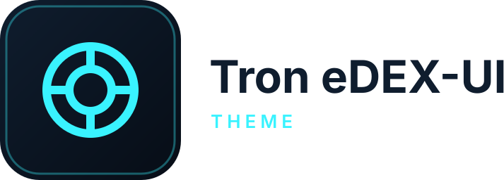

<p align="center">
  <picture>
    <source media="(prefers-color-scheme: dark)" srcset="assets/dark_logo.svg">
    
  </picture>
</p>

# Tron / eDEX-UI Theme for Home Assistant

A dark cyberpunk theme for Home Assistant, inspired by Tron and eDEX-UI: pure black background,
cyan `#39f3ff` primary, amber `#ff9d2e` accent, and cards with a thin glowing cyan border.

## Install

**With HACS:** open HACS, add this repository as a custom repository with category **Theme**
(`https://github.com/kashif-khan/ha-tron-edex-theme`), then download **Tron eDEX-UI Theme** and
restart Home Assistant (or reload themes under *Developer Tools → YAML → Themes*).

**Manually:** copy `themes/tron_edex.yaml` to `<config>/themes/`, make sure your `configuration.yaml`
has `frontend: themes: !include_dir_merge_named themes`, then reload themes.

## Use it

- Per user: **Profile → Theme → tron_edex**. Per device it is stored in the browser.
- For everyone (default): **Settings → System → General → Theme**.

The built-in *Default* theme stays available, so you can switch back at any time without removing this one.

## What it styles

| Area | Details |
|---|---|
| Surfaces | Black primary background, near-black cards with a subtle dark-teal gradient |
| Text | Pale cyan primary text `#d6fbff`, muted cyan secondary text `#6fe3ef` |
| Accents | Cyan icons and controls, amber for active icons and the selected sidebar item |
| Cards | 6 px radius, 1 px cyan border, soft cyan glow |
| Controls | Switches, sliders, tile cards, text fields, dropdowns |
| Chrome | Sidebar, header, dialogs, more-info panels, data tables |

| Colour | Hex |
|---|---|
| Primary | `#39f3ff` |
| Accent | `#ff9d2e` |
| Background | `#000000` |
| Card | `#050f11` |
| Text | `#d6fbff` |
| Error | `#ff5f6d` |

## Light mode

This theme is intentionally always dark. Its `light` mode mirrors the dark one instead of inverting
it, so it looks the same whatever your device's colour scheme.

## Customising

Home Assistant lets you override any theme variable without editing this file. Copy
`themes/tron_edex.yaml` to a new name and change the values you want, for example a different glow:

```yaml
my_tron:
  modes:
    dark:
      ha-card-box-shadow: "0 0 8px rgba(255, 157, 46, 0.35)"
```

## FAQ

**Colours look unchanged after updating.** Reload themes (*Developer Tools → YAML → Themes*) and
hard-refresh the browser (Ctrl+Shift+R).

**Some third-party cards ignore the theme.** Cards that hard-code their own colours aren't affected
by any theme. Check whether the card has a theme or colour option.

## Development

The whole theme is `themes/tron_edex.yaml`. CI validates the YAML and the HACS layout. Brand assets
in `assets/` are generated with the shared script in the
[homelab repo](https://github.com/kashif-khan/homelab/tree/main/homeassistant/tools).

## Credits and licence

Inspired by [eDEX-UI](https://github.com/GitSquared/edex-ui) and Tron. Released under the MIT
licence, see [LICENSE](LICENSE).
